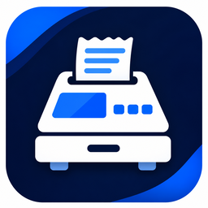
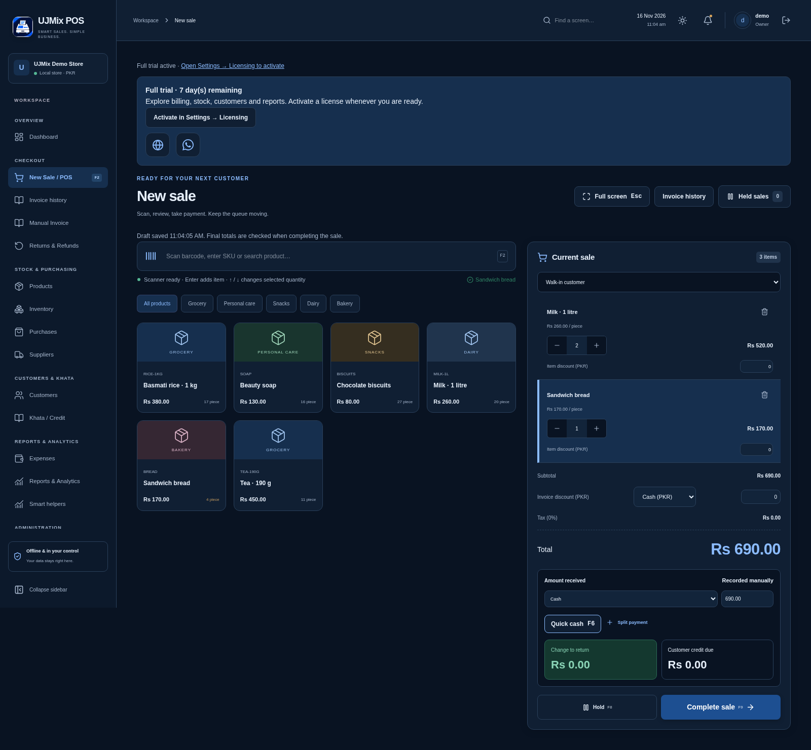

# UJMix POS

**Offline billing, stock and customer credit for Windows.**

This is the official customer download repository. Application development is private. No application source, owner license generator or issuer keys are stored here.

## Download

Windows installers are published under [Releases](https://github.com/usmanjavid/ujmix-pos/releases) after the Windows build and installation checks pass. Choose installation with or without optional local AI. [Download version 0.11.0](https://github.com/usmanjavid/ujmix-pos/releases/tag/v0.11.0).

## What you can do

- Try the full store features for seven days, then activate a purchased license.
- Scan barcodes, create invoices, view history and manage product stock and customer balances.
- Use Quick cash (F6) for the remaining bill balance, with split payments preserved.
- Choose Cash or Percentage invoice discounts in Settings and switch on an individual POS or manual invoice.
- Use three store contact numbers and customize receipt details, messages and paper size. Customize receipts in owner Settings. Software By ujmix.com and a mobile icon with +923156843398 stay on one line at the bottom, separate from your shop details.
- Increase or decrease interface font size. New stores use a four-hour idle timeout; the owner can change it.
- Select Remember me on a trusted Windows account. Sign-out and the configured idle timeout end remembered sign-in; the password is not saved.
- Choose from 165 currency options and six core interface languages: English, Spanish, French, Arabic, Hindi and Urdu. Each store uses one accounting currency; some help text remains in English.
- Make local backups or select a folder synced by your own OneDrive, Proton Drive, Google Drive or Dropbox desktop app.

The optional UJmix Ai assistant and AI settings appear only if the AI model and runtime are installed. The shop setup checklist sits at the bottom of the dashboard.

## Demo preview

*Demo data in PKR. Choose the appropriate accounting currency for your store during setup.*

[Dashboard preview](images/ujmix-pos-dashboard-demo.png) · [Product stock preview](images/ujmix-pos-stock-demo.png)

## Demo and activation

Use **Try demo** for separate sample records. Demo username: `demo` · password: `demo123456`.

The trial starts on first use and lasts seven days. When it ends, activate a license to create new invoices. Saved invoices, printing, records and backups remain available. Terms: 3 months, 6 months, 1 year, 3 years or lifetime. Send your shop name and PC activation code from Settings → Licensing to order. Lifetime means no license expiry; ask about support and upgrade coverage separately.

If you used an earlier UJ Retail license, contact support for reissue before upgrading. Close the old application before installing UJMix POS. The existing store identifier and encryption-key namespace are preserved; keep a tested backup before changing versions.

## Guides and support

[Quick start](docs/QUICK-START.md) · [Backup guide](docs/CLOUD-BACKUP.md) · [Privacy](docs/PRIVACY.md) · [License terms](docs/LICENSE-POLICY.md)

[Website](https://www.ujmix.com/ujmix-pos/) · [WhatsApp +923156843398](https://wa.me/923156843398) · [Email](mailto:usmanjavid@gmail.com)

Test your printer, scanner, currency and local tax requirements before using the software for live shop records. UJMix POS does not claim universal hardware compatibility or worldwide tax certification.
